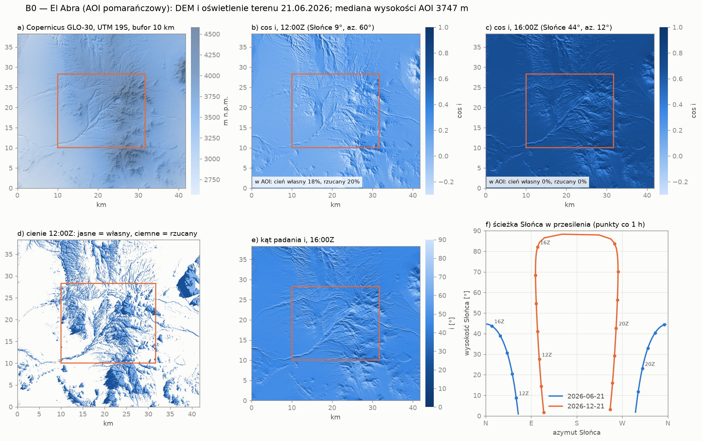

# B0 — przygotowanie regionu: DEM i Słońce

Data: 2026-10-11
Kod: [`src/spectralforge/dem.py`](../src/spectralforge/dem.py),
[`src/spectralforge/solar.py`](../src/spectralforge/solar.py),
[`src/spectralforge/region.py`](../src/spectralforge/region.py)
Skrypty: [`scripts/download_dem.py`](../scripts/download_dem.py),
[`scripts/sun_parameters.py`](../scripts/sun_parameters.py) (`just b0-dem`, `just b0-sun`)
Testy: [`tests/test_dem.py`](../tests/test_dem.py), [`tests/test_solar.py`](../tests/test_solar.py),
[`tests/test_region.py`](../tests/test_region.py)
Przykładowy AOI: [`examples/AOI_el_abra.geojson`](../examples/AOI_el_abra.geojson)

---

## 1. Po co B0

Operator B1 ([dokumentacja](B1_oswietlenie_topografia.md)) potrzebuje danych o regionie,
w którym będą stosowane sygnatury:
- **teren:** rozkład nachyleń i ekspozycji, sky-view, cienie rzucane, wysokość n.p.m.;
- **Słońce:** realne pary (zenit, azymut) dla dat i godzin akwizycji.

Bez B0 trzeba je zgadywać: zakresy jednostajne, syntetyczny DEM, wysokość 0 km. B0 pobiera je dla
wskazanego obszaru (AOI) i przekazuje do B1 w gotowej postaci.

```
AOI.geojson ──► download_copernicus_dem ──► DEM (UTM, bufor) ──► load_region ──► RegionDEM
                                                                                     │
daty/godziny ──► sun_for_aoi ──► SolarPosition ──────────────────────────────────────┤
                                                                                     ▼
                         terrain_illumination (mapy, statystyki)   region_sampler ──► B1 generate_*
```



---

## 2. AOI

Plik GeoJSON w lon/lat (WGS84, zgodnie z RFC 7946): `FeatureCollection`, `Feature` albo sama
geometria. Wszystkie geometrie są łączone w jedną. Pole `crs` inne niż WGS84 (np. EPSG:3857)
jest odrzucane, a nie po cichu źle interpretowane.

---

## 3. DEM: Copernicus GLO-30

### 3.1 Źródło

| | |
|---|---|
| Produkt | Copernicus DEM GLO-30, globalny DSM o rozdzielczości 1″ (~30 m) |
| Dostęp | AWS Open Data, Cloud-Optimized GeoTIFF, bez konta: `https://copernicus-dem-30m.s3.amazonaws.com/<kafel>/<kafel>.tif` |
| Kafle | 1° × 1°, nazwa od narożnika SW, np. `Copernicus_DSM_COG_10_S22_00_W069_00_DEM` = 22°S–21°S, 69°W–68°W |
| Wysokości | ortometryczne, względem geoidy EGM2008 |
| Braki | kafle tylko z oceanem nie istnieją (HTTP 404) i są pomijane z ostrzeżeniem |

### 3.2 Co robi `download_copernicus_dem`

1. Wyznacza docelową siatkę: zasięg AOI w strefie UTM jego centroidu, powiększony o **bufor**
   i dociągnięty do wielokrotności rozdzielczości.
2. Wybiera kafle przecinające ten zasięg (`tiles_for_bounds`).
3. Z każdego kafla czyta przez GDAL `/vsicurl/` **tylko potrzebny fragment** i od razu
   reprojektuje go do siatki docelowej (`WarpedVRT`, interpolacja dwuliniowa).
4. Składa mozaikę i zapisuje GeoTIFF float32 (NaN = brak danych, kompresja deflate). W tagach
   zapisuje źródło, użyte kafle, bufor i zasięg AOI.
5. Jeśli plik już istnieje, używa go ponownie, chyba że podasz `overwrite=True`.

**Po co bufor:** teren poza AOI też rzuca cienie i zasłania niebo nad AOI. Horyzonty liczone
bez bufora są przy krawędziach zaniżone (zob. dokumentację B1, sekcja 2.2). Domyślnie 10 km.
Grzbiet wysoki na 1 km widziany z 10 km wznosi się ok. 5,7° nad horyzont, więc dalszy teren ma
znaczenie tylko przy bardzo niskim Słońcu.

### 3.3 Użycie

```bash
just b0-dem examples/AOI_el_abra.geojson                      # → data/dem/AOI_el_abra_glo30.tif
uv run python scripts/download_dem.py AOI.geojson --out data/dem/x.tif --buffer-km 15 --resolution 30
```

| Opcja | Domyślnie | Znaczenie |
|---|---|---|
| `--out` | `data/dem/<aoi>_glo30.tif` | plik wynikowy |
| `--buffer-km` | 10 | bufor wokół AOI |
| `--resolution` | 30 | piksel wynikowy [m] |
| `--crs` | strefa UTM AOI | np. `EPSG:32719` |
| `--overwrite` | nie | pobierz ponownie |

Wynik dla El Abra (pobranie i reprojekcja trwały ok. 13 s):

```
Wrote data\dem\AOI_el_abra_glo30.tif
  CRS EPSG:32719, 1391 × 1277 px of 30 m
  AOI: 439768 px, elevation 2998–4534 m
  AOI slope: median 10.5°, p95 27.1°
  no-data pixels: 0.0%
  → B1: elevation_km = 3.747
```

### 3.4 `RegionDEM` (`load_region(dem_path, aoi)`)

| Pole / właściwość | Znaczenie |
|---|---|
| `elevation` | wysokości [m], `(rows, cols)`, cały raster z buforem |
| `aoi_mask` | `True` wewnątrz AOI: losujemy tylko stąd, bufor służy wyłącznie jako kontekst horyzontów |
| `transform`, `crs`, `pixel_size` | georeferencja (piksele muszą być kwadratowe) |
| `slope_aspect` | nachylenie i ekspozycja [°] (liczone raz, potem z pamięci podręcznej) |
| `elevation_km` | mediana wysokości w AOI [km], gotowy parametr `elevation_km` dla B1 |
| `center_lonlat` | centroid AOI |

---

## 4. Słońce

### 4.1 Algorytm i dokładność

`solar_position(times, lat, lon)` implementuje algorytm NOAA (ten z NOAA Solar Calculator,
według Meeusa), zwektoryzowany względem czasów i lokalizacji (broadcasting numpy). Porównanie
z NREL SPA (pvlib):

| Przypadek | Δ zenit | Δ azymut |
|---|---|---|
| El Abra, 21.06.2026 14:30Z | −0,001° | +0,001° |
| El Abra, 21.12.2026 15:00Z | +0,002° | +0,001° |
| Kraków, 21.06.2026 10:00Z | −0,001° | −0,004° |
| Tromsø, 15.01.2026 11:00Z (noc polarna) | −0,003° | −0,003° |

To o kilka rzędów wielkości mniej, niż ma znaczenie dla modeli B1. Testy pilnują tolerancji 0,02°.

### 4.2 Czas

- Wewnętrznie wszystko jest w **UTC**.
- Napisy ISO 8601 z przesunięciem (`2026-06-21T10:30-04:00`) i obiekty `datetime` ze strefą
  czasową są przeliczane do UTC; wartości bez strefy są traktowane jako UTC.
- Nie ma zależności od bazy stref czasowych (na Windowsie wymagałaby pakietu `tzdata`). Czas
  lokalny podaj jako przesunięcie w napisie ISO.
- `time_range(start, end, step)` tworzy serię czasów, z krokiem `30s`, `15min`, `1h` lub `1d` (koniec włącznie).

### 4.3 Parametry wyjściowe (`SolarPosition`)

| Pole | Jednostka | Znaczenie | Użycie |
|---|---|---|---|
| `zenith_deg` | ° | zenit geometryczny (bez refrakcji) | — |
| `apparent_zenith_deg` | ° | zenit pozorny, z refrakcją atmosferyczną | **θ_s dla B1** |
| `elevation_deg` | ° | wysokość Słońca nad horyzontem = 90° − zenit pozorny | czytelność, filtrowanie |
| `azimuth_deg` | ° | kierunek **do** Słońca, zgodnie z ruchem wskazówek zegara od północy | **φ_s dla B1** |
| `above_horizon` | bool | Słońce nad horyzontem | odrzucanie nocy |
| `declination_deg` | ° | deklinacja Słońca (pora roku) | diagnostyka |
| `hour_angle_deg` | ° | kąt godzinny: 0 w południe słoneczne, ujemny rano | diagnostyka |
| `equation_of_time_min` | min | równanie czasu: różnica czasu słonecznego i średniego | diagnostyka |
| `local_solar_time_h` | h | lokalny czas słoneczny (12:00 = Słońce najwyżej) | porównanie z godziną przelotu |
| `earth_sun_distance_au` | AU | odległość Ziemia–Słońce | `irradiance_factor` = (1/d)² do irradiancji poza atmosferą (±3,4% w roku) |

Refrakcja jest liczona wzorem NOAA i skalowana ciśnieniem. `sun_for_aoi` dobiera ciśnienie
do wysokości terenu: na 4 km jest ono o ok. 38% niższe, co przekłada się na mniejszą refrakcję
przy horyzoncie. Refrakcja ma znaczenie tylko przy niskim Słońcu (przy 9° nad horyzontem to ok. 0,06°).

### 4.4 Oświetlenie terenu (`terrain_illumination`)

Dla jednej pozycji Słońca i `RegionDEM` liczy mapy:

| Mapa | Znaczenie |
|---|---|
| `cos_i`, `incidence_deg` | lokalny kąt padania promieni na stok (0° = promienie prostopadłe do stoku) |
| `self_shadow` | stok odwrócony od Słońca (cos i ≤ 0) |
| `cast_shadow` | Słońce poniżej horyzontu terenu w swoim azymucie (cień rzucany), śledzony do `max_shadow_distance_m` (domyślnie 5 km) |
| `directly_lit` | ani jedno, ani drugie |

`summary()` zwraca statystyki w AOI: średnie i percentyle cos i, medianę kąta padania oraz
udziały cienia własnego, rzucanego i pikseli oświetlonych. Pomaga to wybrać godziny akwizycji
albo ocenić, ile cieni zobaczy sensor.

### 4.5 Skrypt `sun_parameters.py`

```bash
just b0-sun examples/AOI_el_abra.geojson --time 2026-06-21T14:30Z
uv run python scripts/sun_parameters.py AOI.geojson --start 2026-06-21T10:00Z --end 2026-06-21T22:00Z \
    --step 2h --dem data/dem/AOI_el_abra_glo30.tif --out sun.csv --maps data/output/sun_maps
```

| Opcja | Znaczenie |
|---|---|
| `--time` | czas ISO; można powtarzać |
| `--start`, `--end`, `--step` | seria czasów |
| `--dem` | DEM z `download_dem.py`: dodaje statystyki terenu i `elevation_km` |
| `--min-elevation` | usuń czasy z niższą wysokością Słońca [°] |
| `--max-shadow-km` | zasięg śledzenia cieni rzucanych (domyślnie 5) |
| `--out` | tabela CSV (wszystkie kolumny z sekcji 4.3 i 4.4) |
| `--maps` | GeoTIFF na każdy czas: kanały `cos_i`, `incidence_deg`, `shadow_class` (0 oświetlony, 1 cień własny, 2 rzucany) |

Przykład: El Abra w przesilenie zimowe (21.06.2026), z DEM:

| UTC | Czas słoneczny | Wysokość Słońca | Azymut | średnie cos i | Cień własny | Cień rzucany |
|---|---|---|---|---|---|---|
| 12:00 | 07:23 | 8,8° | 60,3° | 0,12 | 18% | 20% |
| 14:00 | 09:23 | 30,7° | 42,5° | 0,48 | 0,3% | 0,3% |
| 16:00 | 11:23 | 43,7° | 11,9° | 0,66 | 0% | 0% |
| 18:00 | 13:23 | 40,4° | 334,9° | 0,63 | 0% | 0% |
| 20:00 | 15:23 | 23,0° | 309,6° | 0,39 | 2% | 2% |

Rano prawie 40% AOI jest w cieniu, a w okolicy południa cieni praktycznie nie ma. Pora
akwizycji jest więc dla B1 równie ważna jak sam teren. Na końcu skrypt wypisuje gotowe wejścia
do B1. Jeśli azymuty przechodzą przez północ, jak tutaj (334,9° → 11,9°), pojedynczy zakres
(low, high) nie oddaje ich poprawnie. Skrypt to sygnalizuje i każe użyć par (`sun_positions`).

Czas wykonania: ok. 3 s na pozycję Słońca dla rastra 1391 × 1277 px z cieniami do 5 km.

---

## 5. Połączenie z B1

```python
import numpy as np
from spectralforge.dem import download_copernicus_dem, load_aoi, load_region
from spectralforge.io import load_splib_csv
from spectralforge.operators.illumination import generate_physical
from spectralforge.region import region_horizons, region_sampler, sun_for_aoi
from spectralforge.solar import time_range

aoi = load_aoi("examples/AOI_el_abra.geojson")
dem_path = download_copernicus_dem(aoi, "data/dem/AOI_el_abra_glo30.tif")
region = load_region(dem_path, aoi)

times = time_range("2026-05-01T14:00Z", "2026-09-30T16:00Z", "1h")        # okno akwizycji
sun = sun_for_aoi(aoi, times, elevation_km=region.elevation_km)
horizons = region_horizons(region, n_directions=16, max_distance_m=5000)  # sky-view + cienie

lib = load_splib_csv("data/signatures/pcd_minerals 2.csv").select("Alunite")
batch = generate_physical(lib.reflectance, 200, region_sampler(region, sun, horizons),
                          np.random.default_rng(0), lib.wavelengths_nm,
                          elevation_km=region.elevation_km)
```

`region_sampler`:
- losuje **piksele wyłącznie z AOI** (`valid_mask`), z prawdziwymi nachyleniami i ekspozycjami;
- losuje **realne pary (zenit pozorny, azymut)** spośród czasów ze Słońcem nad horyzontem (`sun_positions`), zamiast niezależnych zakresów, które tworzyłyby niemożliwe kombinacje;
- z `horizons` dokłada sky-view i stan cienia rzuconego każdej próbki;
- domyślnie `min_cos_i=-1`, czyli zachowuje stoki samozacienione, co ma sens dla C-correction i modelu fizycznego. Dla modelu cosinusowego i Minnaerta podaj `min_cos_i=0`.

Te same pary można podać innym samplerom: `sample_geometry_uniform(..., sun_positions=(zen, az))`.

W tym przykładzie (459 czasów, maj–wrzesień, 10–12 czasu słonecznego) horyzonty dla całego
rastra liczyły się ok. 30 s. 1400 wariantów alunitu miało medianę nachylenia 10°, a wszystkie
parametry, łącznie ze Słońcem i sky-view, trafiają do `batch.parameters(k)`.

---

## 6. Ograniczenia

1. **GLO-30 to DSM z misji TanDEM-X (dane z lat 2011–2015).** Zawiera obiekty na powierzchni, a w czynnych kopalniach odkrywkowych, takich jak El Abra, nie odzwierciedla obecnej geometrii wyrobiska i zwałowisk. Na stokach wyrobiska nachylenia i cienie mogą się różnić od dzisiejszych.
2. **Jedna pozycja Słońca na AOI** (centroid). Przy AOI rzędu kilkudziesięciu km różnice kątów są poniżej 0,5°.
3. **Zasięg cieni i horyzontów.** Domyślne 5 km pomija dalekie grzbiety. Dla wysokich gór i niskiego Słońca warto zwiększyć `max_shadow_distance_m` / `max_distance_m` i bufor, kosztem czasu obliczeń (liniowo względem zasięgu).
4. **Czas liczenia sky-view** rośnie jak piksele × kierunki × zasięg. Dla obszarów znacznie większych niż ok. 40 × 40 km przy 30 m trzeba liczyć horyzonty na zgrubnym DEM albo przyspieszyć algorytm.
5. **Brak obsługi antypołudnika** (AOI przecinające 180°).
6. **Strefa UTM z centroidu.** Dla AOI rozciągniętych na kilka stref zniekształcenia na brzegach rosną; w razie potrzeby podaj `--crs`.

## 7. Dalsze kroki

- Odczyt geometrii akwizycji z metadanych prawdziwych scen (EMIT `OBS`, EnMAP) zamiast siatki czasów.
- Klimatologia aerozolu dla AOI (AERONET / MODIS) jako zakres `aot_550` dla B1.
- Przyspieszenie horyzontów dla dużych obszarów (horyzont wieloskalowy albo numba).
