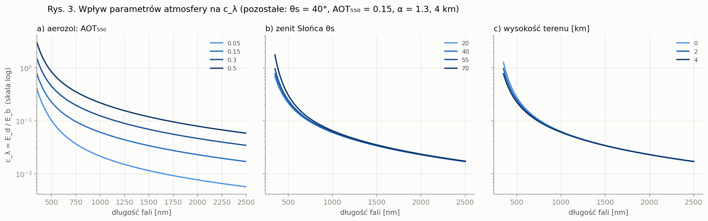
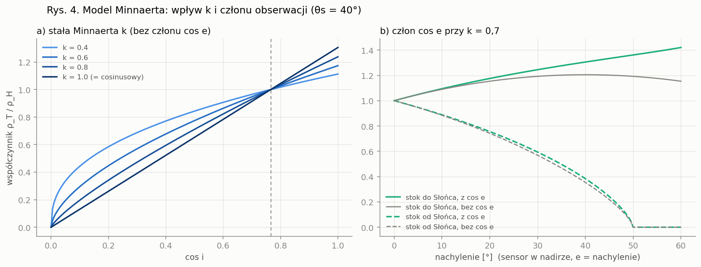
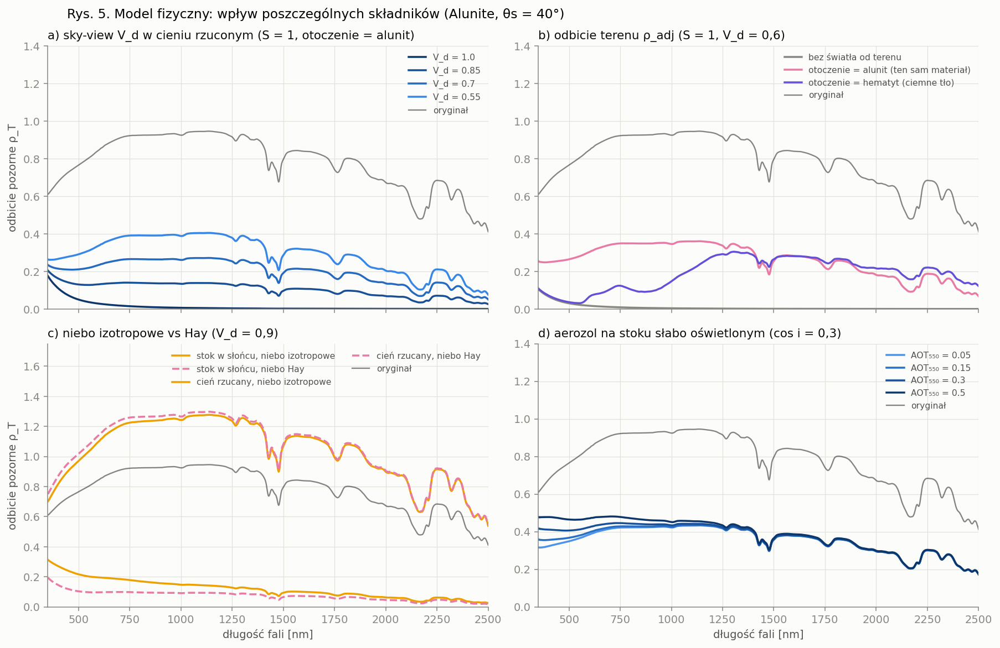
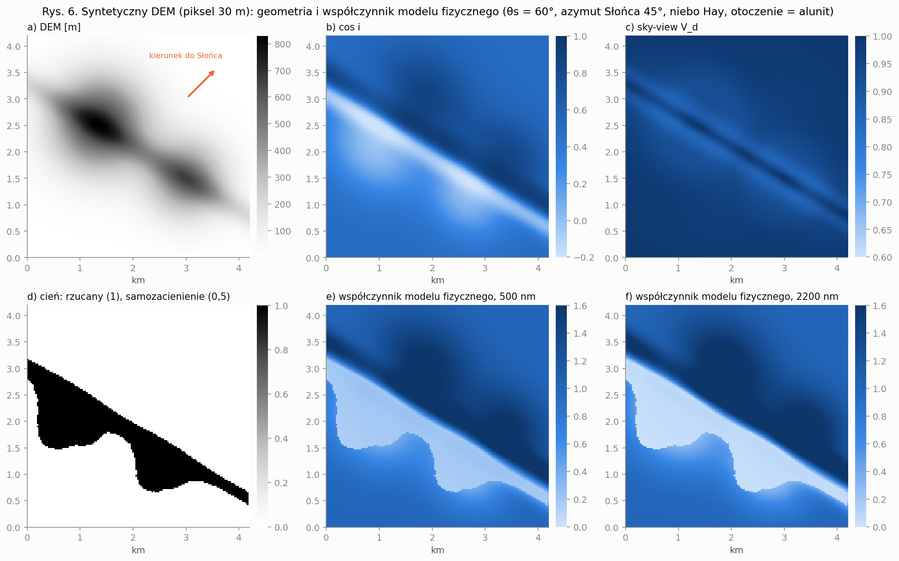
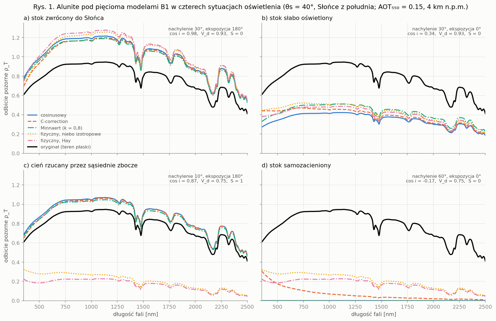
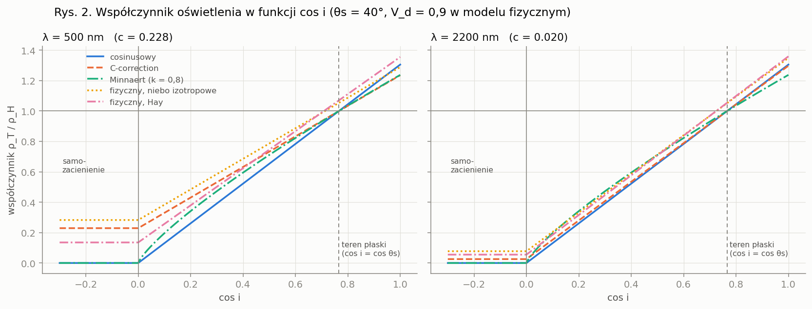
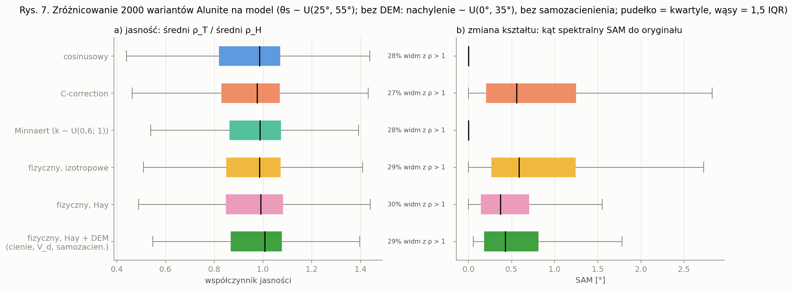

# B1 — operator oświetlenia i topografii

Data: 2026-10-11
Kod: [`src/spectralforge/operators/illumination.py`](../src/spectralforge/operators/illumination.py),
[`src/spectralforge/terrain.py`](../src/spectralforge/terrain.py),
[`src/spectralforge/atmosphere.py`](../src/spectralforge/atmosphere.py)
Testy: [`tests/test_illumination.py`](../tests/test_illumination.py),
[`tests/test_terrain.py`](../tests/test_terrain.py), [`tests/test_atmosphere.py`](../tests/test_atmosphere.py)
Grafiki: [`examples/b1_documentation_figures.py`](../examples/b1_documentation_figures.py) → `docs/figures/`
Kontekst: [Plan badawczy, sekcja 4.1.1](Plan_badawczy_SpectralForge.md) (B1 zastępuje operator A1 „Scaling” z artykułu ESWA 2026).

---

## 1. Do czego służy B1

Widmo z biblioteki (USGS, Ecostress) opisuje powierzchnię **poziomą**, zmierzoną w laboratorium.
Sensor nad terenem górzystym widzi piksele na **stokach**: oświetlonych mocniej lub słabiej,
w cieniu, z ograniczonym widokiem nieba, oświetlanych dodatkowo przez sąsiednie zbocza.
Jeśli korekcja atmosferyczna zakłada teren płaski, w produkcie powstaje **odbicie pozorne** ρ_T
różne od ρ_H.

B1 to klasyczne modele korekcji topograficznej użyte **w kierunku odwrotnym (generacja)**:

```
ρ_T(λ) = ρ_H(λ) · F(λ; geometria, atmosfera, teren)
```

Każdy model oblicza inaczej współczynnik oświetlenia F. Każdy ma też funkcję korekcji (F⁻¹),
która przydaje się do testów (generacja → korekcja = tożsamość) i do pracy na prawdziwych scenach.

### Którą domenę symulujemy?

Zanim użyjesz B1, ustal, jakie dane będą na wejściu modelu downstream:

| Dane docelowe | Co powinien symulować B1 |
|---|---|
| L2A **bez** korekcji topograficznej (prawdopodobnie EMIT L2A; produkt geometrii zawiera `cosine_i`, ale reflektancja nie jest korygowana — *do potwierdzenia w user guide*) | pełny efekt terenu: generacja dowolnym modelem |
| L2A **z** korekcją topograficzną (EnMAP L2A — procesor PACO/ATCOR z DEM, model lambertowski — *do potwierdzenia w metadanych*) | tylko błędy resztkowe korekcji: generacja jednym modelem (np. `physical`), korekcja innym (np. `cosine_correction`) |

---

## 2. Wspólne konwencje

### 2.1 Geometria (wszystkie kąty w stopniach)

| Symbol | Nazwa w kodzie | Znaczenie |
|---|---|---|
| θ_s | `solar_zenith_deg` | zenit Słońca, 0° = Słońce w zenicie, musi być < 90° |
| φ_s | `solar_azimuth_deg` | kierunek **do** Słońca, zgodnie z ruchem wskazówek zegara od północy |
| s | `slope_deg` | nachylenie stoku, 0° = poziomo |
| φ_n | `aspect_deg` | ekspozycja: kierunek, w który stok jest **zwrócony** (w dół stoku) |
| θ_v, φ_v | `view_zenith_deg`, `view_azimuth_deg` | kierunek obserwacji (tylko Minnaert z członem cos e) |

Kąt padania i (`cos_incidence`):

```
cos i = cos θ_s · cos s + sin θ_s · sin s · cos(φ_s − φ_n)
```

- **cos i ≤ 0:** stok samozacieniony (odwrócony od Słońca).
- **cos i = cos θ_s:** odpowiednik terenu płaskiego, F = 1 we wszystkich modelach.

### 2.2 Wielkości terenowe wymagające DEM (`TerrainHorizons`)

| Symbol | Nazwa | Znaczenie | Gdy brak DEM |
|---|---|---|---|
| S | `cast_shadow` | 1 = piksel w cieniu **rzucanym** przez inne zbocze (mimo cos i > 0), 0 = oświetlony | 0 |
| V_d | `sky_view` | sky-view factor: udział nieba widocznego z piksela (Dozier & Frew 1990) | (1 + cos s)/2 (stok bez przesłon) |

`TerrainHorizons.from_dem(dem, pixel_size, n_directions=32)` raz liczy horyzonty w n kierunkach.
Potem dla dowolnej pozycji Słońca podaje V_d i S bez ponownego śledzenia promieni. Uwagi:
- DEM musi być w układzie metrycznym (`pixel_size` w tych samych jednostkach co wysokości), z rastrem zorientowanym na północ.
- Teren poza krawędzią rastra jest traktowany jako nieistniejący, więc przy krawędziach horyzont jest niedoszacowany: cieni jest za mało, a V_d za dużo. Widać to na Rys. 6d.
- Horyzonty poniżej poziomu są przycinane do 0°, czyli zakładamy płaskie otoczenie w dali. Dzięki temu stok bez przesłon daje dokładnie V_d = (1 + cos s)/2 (test w `test_terrain.py`).

### 2.3 Atmosfera (`spectralforge.atmosphere`)

Modele C-correction i fizyczny potrzebują stosunku irradiancji rozproszonej do bezpośredniej:

```
c_λ = E_d(λ) / E_b(λ)        E_b — wiązka bezpośrednia na płaszczyznę prostopadłą do promieni
                             E_d — światło rozproszone nieba na płaszczyznę poziomą
```

`diffuse_to_direct_ratio(wavelengths_nm, solar_zenith_deg, aot_550, angstrom, elevation_km)` liczy c_λ
w przybliżeniu jednokrotnego rozpraszania:
- grubość optyczna Rayleigha według Hansena i Travisa (1974), skalowana ciśnieniem (wysokość terenu),
- aerozol według prawa Ångströma τ_a = AOT₅₅₀·(λ/550)^−α,
- do ziemi dociera połowa światła rozproszonego Rayleighowsko i `aerosol_forward_fraction` (0,8) światła rozproszonego na aerozolu.

`direct_transmittance(...)` = exp(−τ/cos θ_s) to indeks anizotropii A_λ w modelu Haya.

> To **nie jest** kod transferu radiacyjnego. Pomija absorpcję gazów (pasma H₂O/CO₂/O₂),
> rozpraszanie wielokrotne i sprzężenie ziemia–atmosfera. Poprawnie oddaje rząd wielkości
> i trend spektralny. Wartości bezwzględne trzeba porównać z 6S/libRadtran przed użyciem
> w publikacji (`TODO: verify` w kodzie).



**Rys. 3** pokazuje, jak parametry atmosfery wpływają na c_λ:
- **a) Aerozol** ma największy wpływ: od AOT 0,05 do 0,5 c rośnie ok. 8× w niebieskim i ok. 10× w SWIR.
- **b) Zenit Słońca** ma znaczenie głównie w niebieskim i dopiero przy niskim Słońcu (θs = 70°).
- **c) Wysokość terenu** zmniejsza składnik Rayleigha, więc c w niebieskim jest mniejsze na 4 km niż na poziomie morza. W SWIR różnicy praktycznie nie ma.

Dla typowej atmosfery z rysunków (θs = 40°, AOT₅₅₀ = 0,15, α = 1,3, 4 km n.p.m.) wychodzi c₅₀₀ ≈ 0,23 i c₂₂₀₀ ≈ 0,02.

### 2.4 Wejście i wyjście generatorów

Każdy model ma funkcję `generate_<model>(spectra, n_per_spectrum, sampler, rng, ...)`:

| Wejście | Kształt / typ | Opis |
|---|---|---|
| `spectra` | `(n_spectra, n_bands)` lub `(n_bands,)` | widma ρ_H (np. `load_splib_csv(...).select("Alunite").reflectance`) |
| `n_per_spectrum` | `int` | liczba wariantów na każde widmo |
| `sampler` | `(rng, n) → TerrainGeometry` | losowanie geometrii (sekcja 2.5) |
| `rng` | `np.random.Generator` | źródło losowości; ten sam seed daje ten sam zbiór |
| `wavelengths_nm` | `(n_bands,)` | wymagane w C (bez `c`) i w modelu fizycznym |

Wyjście to `SyntheticBatch`:

| Pole | Kształt | Opis |
|---|---|---|
| `reflectance` | `(n_samples, n_bands)` | wygenerowane widma ρ_T, **nieprzycięte** do [0, 1] |
| `source_index` | `(n_samples,)` | indeks widma źródłowego w `spectra` |
| `geometry` | `TerrainGeometry` | geometria każdej próbki |
| `illumination_factor` | `(n_samples,)` albo `(n_samples, n_bands)` | F; dwuwymiarowe, gdy zależy od λ |
| `model`, `operator_code` | `str` | nazwa modelu, `"B1"` |
| `extra` | `dict` | parametry modelu (np. `aot_550`, `k`, `sky_view`) |

`batch.parameters(k)` zwraca słownik parametrów próbki k w postaci gotowej do zapisu w
`spectralforge.operator_runs.parameters` (JSONB). `source_index` mapuje się na
`spectralforge.generation_inputs` (waga 1,0).

**Wyniki > 1 nie są błędem.** Na stokach zwróconych do Słońca odbicie pozorne naprawdę
przekracza wartość dla terenu płaskiego. Odrzucanie i flagowanie takich próbek należy do
guardraila B8, nie do B1. Na Rys. 7 jest to ok. 30% widm alunitu, który jest jasny (ρ ≈ 0,9).

### 2.5 Losowanie geometrii

| Sampler | Kiedy | Co losuje |
|---|---|---|
| `sample_geometry_uniform(rng, n, solar_zenith_deg, solar_azimuth_deg, slope_deg, aspect_deg, min_cos_i=0.0)` | brak DEM regionu; testy | każdy kąt stały albo z U(low, high); V_d i S nieznane (wartości domyślne) |
| `sample_geometry_from_dem(rng, n, slope_deg, aspect_deg, solar_zenith_deg, solar_azimuth_deg, min_cos_i=0.0, horizons=None)` | **zalecany**: realny rozkład nachyleń i ekspozycji regionu | losowe piksele DEM; kąty Słońca z metadanych scen; z `horizons` także V_d i S |

Dla konkretnego obszaru najprościej użyć `spectralforge.region.region_sampler` z
[B0](B0_region.md): pobiera on DEM regionu (Copernicus GLO-30), losuje piksele tylko z AOI
i bierze realne pary (zenit, azymut) Słońca dla zadanych dat i godzin. Oba samplery
przyjmują też takie pary bezpośrednio przez `sun_positions=(zenith, azimuth)`.

`min_cos_i` odrzuca próbki z cos i ≤ `min_cos_i`. Domyślne 0 usuwa samozacienienie, co ma sens
dla modeli cosinusowego i Minnaerta (inaczej powstają widma zerowe). Dla C-correction i modelu
fizycznego podaj `min_cos_i=-1.0`, bo stoki samozacienione są tam oświetlone przez niebo i teren.

---

## 3. Modele

Wszystkie modele spełniają warunek zgodności: **na terenie płaskim F = 1** (test w każdym wariancie).

### 3.1 Model cosinusowy (`cosine`)

Smith i in. 1980; Teillet i in. 1982.

```
generacja:  ρ_T = ρ_H · max(cos i, 0) / cos θ_s
korekcja:   ρ_H = ρ_T · cos θ_s / cos i          (NaN dla cos i < min_cos_i = 0,05)
```

| | |
|---|---|
| **Założenia** | tylko światło bezpośrednie, powierzchnia lambertowska, brak nieba, cieni rzucanych i światła od terenu |
| **Parametry** | brak (tylko geometria) |
| **Wejścia** | cos i, θ_s |
| **Zależność od λ** | **nie**: F jest skalarem |
| **API** | `cosine_factor`, `cosine_illumination`, `cosine_correction`, `generate_cosine` |

**Wpływ:** zmienia tylko jasność widma, w zakresie od 0 (samozacienienie) do 1/cos θ_s (stok
prostopadły do promieni). Kształt widma zostaje taki sam (Rys. 7b: SAM = 0°), więc po
normalizacji, continuum removal albo przy metryce SAM/kosinusowej wszystkie warianty są
identyczne. Stoki odwrócone od Słońca stają się czarne (Rys. 1d), choć w rzeczywistości
oświetla je niebo.

**Kiedy:** jako wariant bazowy w ablacji (Eksperyment 6) i jako najprostszy odpowiednik A1 z artykułu.

### 3.2 C-correction (`c_correction`)

Teillet i in. 1982.

```
generacja:  ρ_T = ρ_H · (max(cos i, 0) + c_λ) / (cos θ_s + c_λ)
korekcja:   ρ_H = ρ_T · (cos θ_s + c_λ) / (cos i + c_λ)
```

| | |
|---|---|
| **Założenia** | jak w modelu cosinusowym plus izotropowe światło nieba widoczne w całości (V_d = 1); bez cieni rzucanych i światła od terenu |
| **Parametr** | c_λ ≥ 0, jeden na pasmo; fizycznie c_λ ≈ E_d/E_b |
| **Źródła c_λ** | (1) `fit_c_coefficients(reflectance, cos_i)`: regresja ρ_T = m_λ·cos i + b_λ na prawdziwej scenie, c_λ = b_λ/m_λ; (2) parametryzacja czystego nieba z losowanym AOT; (3) tablica podana jawnie |
| **Zależność od λ** | **tak**, przez c_λ |
| **API** | `c_factor`, `c_illumination`, `c_correction`, `fit_c_coefficients`, `generate_c_correction(..., wavelengths_nm, c=None, aot_550=(0.05, 0.3), angstrom=1.3, elevation_km=0.0)` |

**Wpływ c_λ:** c to „podłoga” oświetlenia. Przy cos i ≤ 0 zostaje F = c/(cos θ_s + c) (Rys. 2).
Ponieważ c maleje od niebieskiego do SWIR, stoki słabo oświetlone stają się relatywnie
„niebieskie”: kształt widma się zmienia (Rys. 7b: mediana SAM 0,56°, p95 4,4°). Większe c
(więcej aerozolu, niższe Słońce) daje mniejszy kontrast stoków w VNIR.

**Znane ograniczenie:** na stokach samozacienionych SWIR prawie znika (c₂₂₀₀ ≈ 0,02), a cechy
diagnostyczne alunitu w SWIR są niemal wygaszone (Rys. 1d). W rzeczywistości cień jest w SWIR
jaśniejszy, bo dochodzi światło odbite od terenu. To uzupełnia model fizyczny. Przy dopasowaniu
regresją c wchłania część tych efektów i zwykle wychodzi większe niż w parametryzacji czystego nieba.

**Uwaga do `fit_c_coefficients` i `fit_minnaert_k`:** używaj pikseli **jednego, jednorodnego**
typu powierzchni, rozłożonych w szerokim zakresie cos i. Inaczej różnice pokrycia terenu
przenikają do współczynników.

**Kiedy:** wariant domyślny o najlepszym stosunku realizmu do kosztu. Zmienia kształt widma bez DEM.

### 3.3 Minnaert (`minnaert`)

Minnaert 1941; w teledetekcji Smith i in. 1980.

```
L = L_n · cos^k(i) · cos^(k−1)(e)        e — kąt między kierunkiem obserwacji a normalną stoku

generacja:  ρ_T = ρ_H · (cos i / cos θ_s)^k_λ · (cos e / cos θ_v)^(k_λ − 1)
korekcja:   ρ_H = ρ_T / [ten sam współczynnik]
```

cos e liczy `cos_incidence(θ_v, φ_v, s, φ_n)`. Dla sensora w nadirze e = s.
`exitance=False` usuwa człon z cos e (forma uproszczona, często spotykana w literaturze).

| | |
|---|---|
| **Założenia** | empiryczne prawo potęgowe dla powierzchni nielambertowskich; brak światła rozproszonego |
| **Parametr** | stała Minnaerta k > 0 (zwykle 0–1); k = 1 to powierzchnia lambertowska, a model sprowadza się wtedy do cosinusowego |
| **Źródła k** | (1) `fit_minnaert_k(reflectance, cos_i, cos_e=None)`: regresja log-log ln(ρ_T·cos e) = ln ρ_n + k_λ·ln(cos i·cos e); (2) losowe k na próbkę, `k=(low, high)`; (3) tablica k_λ |
| **Zależność od λ** | **tylko z k_λ zależnym od pasma**; skalarne k zmienia wyłącznie jasność |
| **API** | `minnaert_factor`, `minnaert_illumination`, `minnaert_correction`, `fit_minnaert_k`, `generate_minnaert(..., k=(0.6, 1.0), exitance=True, view_zenith_deg=0.0, view_azimuth_deg=0.0)` |



**Wpływ k (Rys. 4a):**
- k < 1 spłaszcza zależność od oświetlenia: stoki słabo oświetlone są jaśniejsze, a stoki zwrócone do Słońca ciemniejsze niż w modelu cosinusowym. Zbiór jest przez to mniej zróżnicowany (Rys. 7a: p5 jasności 0,61 zamiast 0,50).
- Przy cos i → 0 krzywa schodzi do zera, bo model nie ma „podłogi” jak C.

**Wpływ członu cos e (Rys. 4b):** przy k < 1 czynnik (cos e)^(k−1) > 1 rozjaśnia strome stoki,
widziane przez sensor pod dużym kątem. Na stoku 60° zwróconym do Słońca daje to ok. +23%
względem formy uproszczonej.

**Ograniczenie:** nie mamy fizycznej parametryzacji k_λ dla minerałów. Jedyne realne źródło
to `fit_minnaert_k` na scenie bez korekcji topograficznej (np. EMIT nad El Abra, jednorodne
płaty skały). Model nie uwzględnia też zależności k od nachylenia, czyli k(s), stosowanej w części literatury.

**Kiedy:** jako wariant „szorstkość powierzchni”; z k_λ dopasowanym do sceny także jako źródło zmian kształtu.

### 3.4 Model fizyczny (`physical`)

Sandmeier & Itten 1997; Richter 1998 (ATCOR-3); niebo anizotropowe według Hay 1979.

Irradiancja docierająca do piksela ma trzy składniki: bezpośredni, rozproszony z nieba i odbity
od otaczającego terenu. W przeliczeniu na jednostkę irradiancji bezpośredniej (c_λ = E_d/E_b):

```
ρ_T = ρ_H · { [ cos⁺i · (1 − S)  +  c_λ · D ] / (cos θ_s + c_λ)   +   ρ_adj · (1 − V_d) }
              └ bezpośrednie ┘    └ niebo ┘                          └ światło od terenu ┘

cos⁺i = max(cos i, 0)
D = V_d                                                  (niebo izotropowe)
D = A_λ · cos⁺i · (1 − S) / cos θ_s  +  (1 − A_λ) · V_d   (Hay: część okołosłoneczna zachowuje się jak wiązka)
```

| Symbol | Nazwa w kodzie | Zakres | Źródło | Domyślnie |
|---|---|---|---|---|
| c_λ | (liczone) | ≥ 0 | `diffuse_to_direct_ratio` z losowanym AOT | AOT₅₅₀ ~ U(0,05; 0,3), α = 1,3 |
| A_λ | (liczone) | 0–1 | `direct_transmittance` (tylko `diffuse="hay"`) | — |
| V_d | `geometry.sky_view` | 0–1 | `TerrainHorizons` | (1 + cos s)/2 |
| S | `geometry.cast_shadow` | 0–1 | `TerrainHorizons` | 0 |
| ρ_adj | `terrain_reflectance` | widmo | `"self"` (ten sam materiał), widmo tła, `None` (bez członu) | `"self"` |
| — | `diffuse` | `"isotropic"`, `"hay"` | — | `"hay"` |
| — | `elevation_km` | ≥ 0 | wysokość terenu (Rayleigh) | 0 |

**Przypadki szczególne (testowane):**
- teren płaski i otwarty (cos i = cos θ_s, V_d = 1, S = 0) daje tożsamość;
- V_d = 1, S = 0, niebo izotropowe i brak członu terenu dają dokładnie C-correction.

**Korekcja** (`physical_correction`): dla `terrain_reflectance="self"` model jest kwadratowy względem ρ_H
(ρ_T = a·ρ_H + (1 − V_d)·ρ_H²) i rozwiązywany przez dodatni pierwiastek.

**API:** `physical_factor`, `physical_illumination`, `physical_correction`,
`generate_physical(..., wavelengths_nm, aot_550=(0.05, 0.3), angstrom=1.3, elevation_km=0.0, diffuse="hay", terrain_reflectance="self")`.



**Wpływ składników (Rys. 5):**
- **a) V_d w cieniu rzuconym.** Przy jasnym otoczeniu (alunit) **mniejsze** V_d daje **jaśniejszy** piksel, bo światło odbite od jasnych zboczy przewyższa utracone światło nieba. Przy V_d = 1 w cieniu zostaje tylko niebo, a widmo prawie znika poza niebieskim.
- **b) Odbicie terenu ρ_adj.** Światło od zboczy wnosi **kształt widma otoczenia**. Przy otoczeniu hematytowym piksel alunitu w cieniu ma w VNIR cechy hematytu (absorpcja Fe poniżej ok. 900 nm). To naturalna, fizycznie umotywowana kontaminacja widma, bezpośrednio związana z modułem M7 (tło niemineralne).
- **c) Niebo izotropowe a Hay.** Na stokach w słońcu Hay daje 2–5% więcej (część okołosłoneczna działa jak wiązka). W cieniu rzuconym składnik nieba spada o ok. 70% przy 500 nm i o ponad 90% w SWIR, bo przy czystej atmosferze A_λ = T_b jest bliskie 1, a ta część jest zasłonięta razem ze Słońcem. Całe widmo w cieniu, razem ze światłem od terenu, jest w VNIR mniej więcej o połowę ciemniejsze niż przy niebie izotropowym. Wybór modelu nieba to najsilniejszy pojedynczy parametr dla pikseli w cieniu.
- **d) Aerozol.** Na stoku słabo oświetlonym liczy się prawie wyłącznie poniżej ok. 1000 nm. Więcej aerozolu oznacza więcej światła rozproszonego, czyli jaśniejszy i bardziej „płaski” VNIR.

**Ograniczenia:**
- nadal zakłada powierzchnię lambertowską (brak BRDF);
- światło od terenu liczy jednym odbiciem, z jednym widmem ρ_adj dla całego otoczenia;
- atmosfera jest uproszczona (sekcja 2.3);
- cień jest binarny, bez półcienia;
- V_d i S są wiarygodne tylko z DEM, a przy krawędziach rastra niedoszacowane (sekcja 2.2).

**Kiedy:** gdy potrzebny jest realizm w terenie górzystym, zwłaszcza dla cieni i dolin. Z DEM
regionu to wariant docelowy i podstawa generatora scen (Faza 3).



**Rys. 6** pokazuje cały łańcuch na syntetycznym DEM (dwa wzgórza i grzbiet, piksel 30 m,
Słońce z NE na 30° nad horyzontem):
- **b)** cos i z DEM,
- **c)** V_d, obniżone w dolinie między wzgórzami,
- **d)** cień rzucany na stronę SW,
- **e–f)** współczynnik modelu fizycznego. W cieniu współczynnik przy 500 nm (ok. 0,15–0,25) jest kilkukrotnie wyższy niż przy 2200 nm (ok. 0,03–0,08), bo światło nieba jest „niebieskie”, a w SWIR zostaje głównie światło od terenu.

---

## 4. Porównanie modeli



**Rys. 1** pokazuje te same cztery sytuacje we wszystkich modelach. Modele cosinusowy, C
i Minnaert **nie wiedzą o cieniu rzucanym** (panel c) i traktują taki piksel jak oświetlony.
Tylko model fizyczny go przyciemnia. Na stoku samozacienionym (panel d) modele cosinusowy
i Minnaert dają zero, C daje widmo „niebieskie” bez cech w SWIR, a model fizyczny zachowuje
cechy alunitu dzięki światłu od terenu.



**Rys. 2:** wszystkie krzywe przecinają się w F = 1 przy cos i = cos θ_s. Przy 500 nm modele
z niebem mają wyraźną „podłogę” przy cos i ≤ 0. Przy 2200 nm (c ≈ 0,02) wszystkie modele są
bliskie cosinusowemu, a różnice tworzy głównie człon terenu.



**Rys. 7:** 2000 wariantów jednego widma alunitu na model, θ_s ~ U(25°, 55°).

| Model | Jasność p5–p95 | SAM: mediana / p95 | Widma z ρ > 1 |
|---|---|---|---|
| cosinusowy | 0,50–1,26 | 0,00° / 0,00° | 28% |
| C-correction (AOT ~ U(0,05; 0,3), 4 km) | 0,56–1,24 | 0,56° / 4,41° | 27% |
| Minnaert (k ~ U(0,6; 1)) | 0,61–1,24 | 0,00° / 0,00° | 28% |
| fizyczny, niebo izotropowe | 0,56–1,25 | 0,58° / 4,06° | 29% |
| fizyczny, Hay | 0,57–1,31 | 0,37° / 2,00° | 30% |
| fizyczny, Hay + DEM (cienie, V_d, samozacienienie) | 0,51–1,32 | 0,42° / 2,51° | 29% |

Wnioski:
- Zmienność **kształtu** (SAM > 0), czyli to, co widzi sieć metric-learning po normalizacji, dają tylko modele z atmosferą: C i fizyczny.
- Hay daje mniejsze zmiany kształtu niż niebo izotropowe, bo część światła nieba „idzie za Słońcem”.
- Pojedyncze wartości SAM rzędu kilku stopni pochodzą ze stoków słabo oświetlonych i cieni.

### Ściąga wyboru

| Potrzeba | Model |
|---|---|
| Wariant bazowy do ablacji, odpowiednik A1 | `cosine` |
| Zmiana kształtu widma bez DEM, niski koszt | `c_correction` (domyślnie) |
| Szorstkość powierzchni; k_λ dopasowane do sceny | `minnaert` |
| Realizm w terenie górzystym, cienie, doliny, kontaminacja otoczeniem; Faza 3 | `physical` + `TerrainHorizons` |
| Dopasowanie do konkretnej sceny docelowej | `fit_c_coefficients` / `fit_minnaert_k`, potem `c=` / `k=` |
| Błędy resztkowe dla danych skorygowanych topograficznie (EnMAP) | generacja `physical`, korekcja `cosine_correction` lub `c_correction` |

---

## 5. Przykład użycia

```python
from functools import partial
import numpy as np

from spectralforge.io import load_splib_csv
from spectralforge.operators.illumination import generate_c_correction, generate_physical
from spectralforge.terrain import TerrainHorizons, sample_geometry_from_dem, sample_geometry_uniform

lib = load_splib_csv("data/signatures/pcd_minerals 2.csv").select("Alunite")
rng = np.random.default_rng(0)

# Bez DEM: C-correction z losową atmosferą (stoki samozacienione też, bo oświetla je niebo)
sampler = partial(sample_geometry_uniform, solar_zenith_deg=(25, 55), min_cos_i=-1.0)
batch = generate_c_correction(lib.reflectance, 100, sampler, rng, lib.wavelengths_nm, elevation_km=4.0)

# Z DEM regionu: model fizyczny z cieniami i sky-view
horizons = TerrainHorizons.from_dem(dem, pixel_size=30.0)          # dem: ndarray w metrach
sampler = partial(sample_geometry_from_dem, slope_deg=horizons.slope_deg,
                  aspect_deg=horizons.aspect_deg, solar_zenith_deg=(25, 55),
                  solar_azimuth_deg=(0, 360), min_cos_i=-1.0, horizons=horizons)
batch = generate_physical(lib.reflectance, 100, sampler, rng, lib.wavelengths_nm, elevation_km=4.0)

batch.reflectance       # (700, 2151) — widma syntetyczne
batch.parameters(0)     # parametry próbki 0 do operator_runs.parameters
```

Grafiki z tego dokumentu odtwarza `python examples/b1_documentation_figures.py`
(z `PYTHONPATH=src`). Podglądy pojedynczych modeli są w `examples/b1_*_alunite.py`.

---

## 6. Ograniczenia całego operatora i otwarte kwestie

1. **Atmosfera jest uproszczona.** c_λ i A_λ trzeba zweryfikować względem 6S/libRadtran. W pasmach absorpcji gazów parametryzacja jest najmniej wiarygodna.
2. **Brak BRDF.** Wszystkie modele poza Minnaertem zakładają powierzchnię lambertowską.
3. **Brak k_λ dla minerałów.** Minnaert zmienia kształt widma tylko z k_λ dopasowanym do sceny.
4. **Krawędzie DEM.** Horyzonty przy krawędzi rastra są niedoszacowane. Warto liczyć je na DEM z buforem większym niż obszar losowania.
5. **Domena danych docelowych.** Trzeba potwierdzić w dokumentacji EMIT/EnMAP, czy L2A jest skorygowany topograficznie (sekcja 1).
6. **Guardrail B8.** Próbki z ρ > 1 oraz próbki o bardzo niskim sygnale (cień przy V_d ≈ 1) powinny być flagowane przez B8.
7. **SCS / SCS+C** (Gu & Gillespie 1998; Soenen i in. 2005) nie są zaimplementowane. Dotyczą koron drzew, nie skały, więc są do rozważenia przy tle roślinnym (M7).

---

## 7. Literatura

- Dozier J., Frew J. (1990). Rapid calculation of terrain parameters for radiation modeling from digital elevation data. *IEEE TGRS* 28(5).
- Gu D., Gillespie A. (1998). Topographic normalization of Landsat TM images of forest based on subpixel sun–canopy–sensor geometry. *Remote Sensing of Environment* 64.
- Hansen J. E., Travis L. D. (1974). Light scattering in planetary atmospheres. *Space Science Reviews* 16.
- Hay J. E. (1979). Calculation of monthly mean solar radiation for horizontal and inclined surfaces. *Solar Energy* 23.
- Minnaert M. (1941). The reciprocity principle in lunar photometry. *Astrophysical Journal* 93.
- Richter R. (1998). Correction of satellite imagery over mountainous terrain. *Applied Optics* 37(18).
- Sandmeier S., Itten K. I. (1997). A physically-based model to correct atmospheric and illumination effects in optical satellite data of rugged terrain. *IEEE TGRS* 35(3).
- Smith J. A., Lin T. L., Ranson K. J. (1980). The Lambertian assumption and Landsat data. *Photogrammetric Engineering and Remote Sensing* 46(9).
- Soenen S. A., Peddle D. R., Coburn C. A. (2005). SCS+C: a modified sun-canopy-sensor topographic correction in forested terrain. *IEEE TGRS* 43(9).
- Teillet P. M., Guindon B., Goodenough D. G. (1982). On the slope-aspect correction of multispectral scanner data. *Canadian Journal of Remote Sensing* 8(2).

<!-- TODO: verify this — szczegóły bibliograficzne (tomy, numery) podane z pamięci; potwierdzić przed cytowaniem w publikacji. -->
